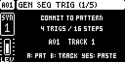
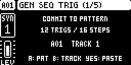

# Commit to Pattern timing fix in 0.4.15

GEN SEQ 0.4.15-dev fixes two capture failures found by extending the OS 1.11
playback tests across tempos, speeds and live arming positions. The live
phrase, pitch and rhythm algorithms are unchanged. The frame-side ANC clock
keeps its existing subdivision-boundary polling cadence.

The combined developer image is:

`out/genseq/0.4.15-capture-queued/genseq-waverider-lfopreview-0.4.15-dev-persist_DN2_1.11.syx`

SHA-256: `b9b3ddf4e32f7b35d761111ae18d5367fa1a71f75b68ce8464de51875f201e75`.
It includes Waverider and LFO Preview and was built with GCC 13.3. No instrument
was flashed. Test evidence is under `out/genseq/0.4.15-capture-tests/`.

## Causes and changes

### Capture mistook a timing counter for a pause flag

The old `CLOCK_HELD` check read `0x42c4e908`. Stock reloads this counter to
900,000 at `0x400daa88` and subtracts timing quanta at `0x400daad6`. Nonzero
values are normal during playback. They do not indicate a paused transport.

The old firmware recorded only four of twelve GRV 32 hits at 300 BPM / 2×,
and eight of twelve at 120 BPM / 2×. Both takes incorrectly reached READY.
The new timing harness reproduces these failures against the original 0.4.14
image, independently matching captured values to live DSP-bound note events.

Before, at 300 BPM / 2×:



After:



Capture now tests the verified stock running state at `0x42c5a918`.
PLAY sets it to 1. STOP clears it to 0. The timestamp at `0x44648480` can still
advance while stopped, so its movement alone cannot indicate playback.
Capture continues to cancel when transport generation, source or clock layout
changes. The existing startup handling still skips the partial cached cycle.

The same counter remains useful to schedule the existing live ANC frame poll
at stock subdivision boundaries. It is now named `CLOCK_REMAINDER`, with its
actual meaning documented. Its use in that live path has not changed.

### A queued note could predate capture arming

The tempo/speed matrix exposed another failure at 1×, 3/4× and 1/8×:
stock could queue the next cycle's first note before the player armed capture.
The old tag hook ignored records while capture was inactive, and arming cleared
the tags. The take then failed with a missing record identity at its first
admission. Waiting for a published clock cycle alone did not fix this, because
stock can prepare a record before publishing its step.

The tag hook now remembers each queued pool record's step and generated/host
identity before arming. Arming retains those bounded tags. It does not read
or modify the generator's phrase state, consume random values or evaluate
another note.

Stock initializes 128 records at `0x44640c28`, each 108 bytes long, at
`0x401388b4`. The pool ends at `0x44644228`. Their existing `/4 mod 128` tag
indices are distinct because the stride is 27 words. Scratch records and the
cached startup copy lie outside that pool and are excluded, so they cannot
overwrite a queued record's identity. Admission still verifies the exact
record pointer. The tag array remains 128 entries and adds no RAM.

FILL's host-position override is also retained when its record is prepared
before arming. Its eligibility follows that record's source configuration,
not whichever capture mode was last selected.

## Timing and musical-content checks

`scripts/emu_genseq_capture_clock.py` runs a 31-case matrix on the actual
combined image. Fixture setup uses a disposable RAM thunk and stock pattern
fields. Capture, paste, scheduling and note dispatch use the production code.
No direct call advances the generator from the test or UI.

The matrix covers:

- 120 and 300 BPM at every stock SPEED: 2×, 3/2×, 1×, 3/4×, 1/2×, 1/4× and 1/8×.
- 30 BPM and approximately 64 BPM. Playback intervals independently verify
  the selected tempo and effective speed.
- Track lengths 1, 3, 7, 12, 16 and 128, including repeated/truncated rhythm cells.
- SEQ, FILL and GEN, physical swing flags, different arming offsets, arming
  before PLAY, arming while paused and resuming, ANC and silent GEN at ACT 0.

For each source note in the captured cycle, the harness follows its producer
tag and stock admission deadline. It then reads the note from the subsequent
DSP-bound frame. The expected step/pitch map therefore does not come from
capture's own accepted-note list. It checks that every expected rhythm step
actually sounded, then compares the complete capture against those pitches.

After paste onto track 2, the source is disabled and playback runs again.
The harness checks the repeated captured pitches, resized track length,
destination GEN SEQ OFF and onset timing. Swing cases also assert that odd
source steps have delayed deadlines. A silent take must paste and
remain silent. No notes may remain after STOP.

All 31 cases passed. The largest timing difference between the source
deadlines and repeated pasted onsets was 85,250 emulator instructions, below
one 88,000-instruction audio-frame interval. The 128-step case captured all
96 expected GRV 32 hits. Silent GEN captured zero and pasted a silent track.

All 16 existing commit workflows also passed, including clipboard ownership,
undo, locks, Euclidean FILL, cross-pattern paste, cancellation and reboot into
stock firmware to play committed trigs. The focused host tests passed:
71 tests, with 35 slow cases deselected. The separate CLI emulator runs above
exercise the actual combined image.

## Live-playback comparison

The 16 OFF/SEQ/FILL/GEN runs at 1, 4, 8 and 16 tracks emit identical note,
voice and release sequences to 0.4.14. These use full-range weighted pitches
and high MUT/REGEN. The largest relative packet timing shift is 412 emulator
instructions, about 3.1 microseconds at the configured instruction clock.

Audio-frame peaks in this comparison are unchanged. At 16 tracks they are
86,802 instructions in OFF, 94,826 in SEQ/FILL and 94,122 in GEN. Remembering
tags adds scheduler work: exclusive peaks changed from 18,289 to 19,009 in
OFF, 25,907 to 26,627 in SEQ, 28,699 to 29,963 in FILL, and 26,680 to 26,920 in
GEN. These are emulator instruction counts, not hardware cycle measurements.
The earlier occasional frame-slot overruns remain a hardware timing check.

The 16-track live operations test also emits the same 160 note/release packet
events as 0.4.14 before paste, while capture now records all twelve hits.
Paste, four TEMP edit/restore round trips and project save complete with no
faults, watched software resets, misses or queue drops. The difference in
playback after paste is intentional: the destination now has twelve trigs
instead of the old incomplete four.

The additional 16-track stress checks passed with Waverider active: eight
slices of short-track ANC, and sixteen slices of UI, pattern and transport
changes. The latter covered about 72.6 emulated seconds. Both completed with
zero faults, misses and drops, a responsive editor and clean voice releases.

### Existing sensitivity at extreme ANC rates

One extra comparison did not produce identical evolving pitches: 16 GEN
tracks at 300 BPM / 2×, stock LENGTH 1, PHRASE LEN 64 and MUT 99. The source
emits the same 84 onset frames, but mutation eventually chooses different
pitches. SEQ in that configuration matched 0.4.14 exactly.

This sensitivity also reproduces without changing the firmware. On 0.4.14,
delaying PLAY by 1,100,000 instructions changed pitches from onset frame 13.
Opening the editor before PLAY changed pitches from frame 9. A one-instruction
or 44,000-instruction delay did not change them. The test changed no musical
controls or seeds. With MUT and REGEN both zero, 0.4.14 and 0.4.15 emit
identical pitches and releases in this same extreme GEN configuration, with
zero relative packet timing shift.

The live ANC clock and its bounded region processing remain unchanged in this
fix. Exact mutation-sequence reproducibility at that extreme region rate is
an existing limitation, not a passed comparison. The raw controls and traces
are in `old-anchor-jitter/`, `locked-anchor-compare/` and
`queued-anchor-compare/`. The capture tests compare against what actually
sounded in each take, so this distinction does not conceal a capture loss.

## Reproduce

```sh
./tools/with_m68k_gcc13.sh .venv/bin/python scripts/build_genseq.py \
  --persistence-probe \
  --waverider-preview-base out/genseq/hardware-test/waverider-lfopreview-base.syx \
  --out out/genseq/0.4.15-capture-queued

FW=out/genseq/0.4.15-capture-queued/genseq-waverider-lfopreview-0.4.15-dev-persist_DN2_1.11.syx

.venv/bin/python scripts/emu_genseq_capture_clock.py "$FW" \
  --jobs 2 --out out/genseq/0.4.15-capture-tests/queued-matrix

./tools/with_m68k_gcc13.sh .venv/bin/python scripts/emu_genseq_commit.py "$FW" \
  --matrix --out out/genseq/0.4.15-capture-tests/queued-workflows

.venv/bin/python scripts/emu_genseq_operations_perf.py "$FW" \
  --out out/genseq/0.4.15-capture-tests/queued-operations
```

For instrument acceptance, the owner should arm Commit to Pattern during
playback near the end of a cycle at 120 and 300 BPM. Repeat at 1×, 2× and 1/8×,
with swing, in SEQ/FILL/GEN. Compare the take's trig count and pasted pitches
with the heard source. Include STOP cancellation, another capture after undo,
and the intended Waverider/effects load. Hardware timing is not established by
these emulator instruction counts.
