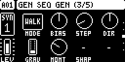
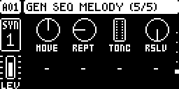

# GEN SEQ

User guide for GEN SEQ 0.4.12-dev on Digitone II OS 1.11.

GEN SEQ makes melodies on synth tracks. Use SEQ to keep the rhythm you programmed, FILL to add notes in its gaps, or GEN to generate the rhythm as well. Each track has its own settings for each pattern.

Builds marked **-persist** store the controls and rhythm and melody seeds in the project. Use **[FUNC] + [YES]** to save the temporary pattern. Use **[FUNC] + [NO]** to reload it. Saving and loading a project preserves the settings for all 128 patterns. Sequence copy, paste, clear and undo include GEN SEQ settings. Loading a sound preset keeps the track's GEN SEQ settings.

Builds without **-persist** keep settings for the session. Commit to Pattern is unavailable.

### Copy a track's settings

Hold **[TRACK]** and press **[COPY]** to copy the track preset and its GEN SEQ controls and seeds. Select the destination track. Hold **[TRACK]** and press **[PASTE]**. This also works between patterns. The destination keeps its programmed trigs.

Press **[TRACK] + [PASTE]** again to undo the paste. **[TRACK] + [CLEAR]** resets the preset and GEN SEQ settings. Repeat it to undo. Copying a track with no GEN SEQ settings switches the destination's GEN SEQ mode to OFF. Track-preset and sequence clipboards keep separate copies.

## Open GEN SEQ

1. Select a synth track.
2. Press **[FUNC] + [SEQ]** to open Euclidean.
3. Press **[FUNC] + [SEQ]** again to open GEN SEQ.
4. Press **[UP]** or **[DOWN]** to change pages. Turn **DATA ENTRY A–H** to edit the matching control. Boxed controls keep their name visible during edits. Gauge labels briefly show the value during edits. The right-hand dots mark the selected page. Each page shows status between the two rows of controls.
5. Press **[NO]** or **[FUNC] + [SEQ]** to return to Euclidean.

Turn **LEVEL/DATA** to change track level. Hold **[FUNC]** while turning it to open LOAD PRESET. Press **[YES]** to open the actions menu.

Select an action with **[UP]** or **[DOWN]**. Press **[YES]** to run it. **NEW RHYTHM** picks a new seed for RANDOM rhythms in FILL or GEN. **NEW PHRASE** rebuilds the melody for the selected track. Press **[NO]** to close the actions menu.

The sequencer makes four decisions for each note. **TRIG** decides which steps play. **PHRASE** reads the next value in its loop. **GEN** supplies the values that fill that loop. **PITCH** and **MELODY** turn each value into a note, using the range, scale, and preferences you set. The stock track clock sets the timing.

## 1. TRIG

| Encoder | Control | Function | Default |
|---|---|---|---|
| A | MODE | **OFF** plays the stock sequence. **SEQ** changes eligible pitches on existing trigs. **FILL** adds hits in gaps and generates pitches for eligible hits. **GEN** supplies the track’s sequenced hits. Live playing stays available. | OFF |
| B | BANK | **GROOVE** contains curated rhythms, **MATH** contains regular and interleaved patterns, and **RANDOM** uses repeatable seeded patterns. | GROOVE |
| C | PAT | Select pattern 1–32 from the bank. Turn faster to move through several patterns at a time. The mask repeats every 16 steps and restarts at the stock track reset. | 1 |
| D | MOD | **NONE** uses PAT as shown. **SHIFT** rotates hits. **FACTOR** redistributes hits within the cell. **NEIGHBOR** offsets the selected pattern number. | NONE |
| E | VAR | SHIFT moves −15 to +15 steps. FACTOR uses odd multipliers ×1 to ×15. NEIGHBOR offsets PAT by −15 to +15 and stops at the bank edges. Changing MOD resets VAR. | 0 or ×1 |
| F | ACT | 0% removes all generated hits. 100% enables every hit in the cell. Lower values keep a repeatable subset. | 100% |

Filled marks show programmed trigs. A center mark shows a pitch override. Hollow marks show generated hits. The underline follows the stock playhead.

BANK through ACT affect FILL and GEN. VAR shows a dash with MOD set to NONE. In FILL, a programmed note or lock trig reserves its step even when a condition prevents it from firing. SEQ works with stock Euclidean timing. Eligible single-note trigs receive generated pitches. Programmed chords and unsupported note forms keep their stock pitches.

Changing MODE restarts the current phrase at PHASE in EVT and clears the previous-note context. In ANC, the track clock selects the current region. Mode changes retain the phrase values and seeds. MUT and REGEN can change the phrase during subsequent playback.

## 2. PHRASE

| Encoder | Control | Function | Default |
|---|---|---|---|
| A | LEN | Loop length of 1–64 eligible note events. **INF** generates a continuous stream and is available with RANDOM or WALK. Hold **[FUNC]** to step through INF, 1, 2, 3, 4, 6, 8, 12, 16, 24, 32, 48, and 64. | 8 |
| B | ADV | EVT counts eligible note events. ANC divides the track cycle into LEN regions. | EVT |
| C | PHASE | Starting slot, from 0 to LEN minus 1. PHASE 2 starts at the third slot. | 0 |
| D | MUT | 0–100% chance to replace a value when its slot is revisited. | 0% |
| E | HOLD | 0–100% chance in EVT to reuse the previous melodic value and pause the loop cursor for that event. | 0% |
| F | REGEN | 0–100% chance to replace the whole phrase after a loop. | 0% |

The bars show the stored phrase. The underline shows the latest slot. At
LEN INF, the bars show recent values. A changed slot briefly flashes when it
mutates.

In EVT, LEN counts notes that reach the melody generator. With four eligible notes per bar and HOLD at zero, LEN 8 plays over two bars. Rests and skipped trigs leave the cursor in place. HOLD repeats the value. MELODY can still choose a different note from that value as the previous note changes.

ANC advances through rests. Every note in an anchor region uses that region's
latent value. PHASE rotates the regions. MUT rolls once when the clock
revisits a region. ANC disables HOLD and REGEN. Selecting ANC at LEN INF
sets LEN to 8.

Turning MUT back to zero keeps the values already in the loop. To restore a SHAPE ramp, select **[YES] → NEW PHRASE**. STOP and PLAY return the cursor to PHASE and retain the current values.

## 3. GEN

| Encoder | Control | Function | Default |
|---|---|---|---|
| A | MODE | **RANDOM** draws independent values. **WALK** moves from the previous value. **SHAPE** samples a contour over a finite phrase. | WALK |
| B | BIAS | −100% to +100%. Favor lower or higher values in RANDOM or move the center of WALK. | 0% |
| C | STEP | 0–100%. Set how far WALK typically moves. Zero holds the current value. | 18% |
| D | DIR | −100% to +100%. Favor downward or upward motion in WALK. | 0% |
| E | GRAV | 0–100%. Pull WALK toward its center. BIAS sets where that center lies. | 25% |
| F | MOMENT | 0–100%. Set the chance that WALK keeps moving in the same direction. | 35% |
| G | SHAPE | Choose UP, DOWN, TRIANGLE, SINE, or ALTERNATE. A length of 1 uses the midpoint. | UP |

The graph shows recent values for RANDOM and WALK and the configured contour for SHAPE. STEP through MOMENT apply to WALK. SHAPE requires SHAPE mode. Selecting SHAPE from LEN INF sets LEN to 8. Hold **[FUNC]** while turning a percentage control to snap to its minimum, center, or maximum.

## 4. PITCH

| Encoder | Control | Function | Default |
|---|---|---|---|
| A | ROOT | Choose C–B or inherit the root from KEYBOARD SETUP (**KEY**). | KEY |
| B | SCALE | Choose a stock named scale, CHROMATIC, or inherit the scale from KEYBOARD SETUP (**KEY**). | KEY |
| C | LOW | Set the lowest note, up to HIGH. | C4 (MIDI 48) |
| D | HIGH | Set the highest note, down to LOW. | C6 (MIDI 72) |
| E | BIAS | −100% to +100%. Give lower or higher notes more weight within the selected range. | 0% |

The center shows the legal pitch range and the latest generated note. Hold **[FUNC]** and turn LOW or HIGH to move by octaves. The bounds apply before stock transpose. If the range has no note in the selected scale, a programmed trig keeps its pitch and a generated hit stays silent.

## 5. MELODY

| Encoder | Control | Function | Default |
|---|---|---|---|
| A | MOVE | −100% to +100%. Prefer smaller or larger intervals from the previous generated note. | 0% |
| B | REPEAT | 0–100%. Set the weight for repeating the same pitch. 25% is neutral. | 25% |
| C | TONIC | 0–100%. Favor stable degrees in a named scale, with the strongest weight on its root. | 0% |
| D | RESOLVE | 0–100%. Favor a nearby stable degree after a less stable degree. | 0% |

The graph connects the last 16 generated notes. The previous generated note sets the context for MOVE and REPEAT.
TONIC and RESOLVE apply to named scales. The first generated note has no previous-note context.

With a finite EVT phrase and MUT, HOLD and REGEN at zero, MELODY context restarts at each phrase boundary. The first loop and later loops play the same melody. Infinite phrases and phrases with mutation, hold or regeneration keep their context across phrase boundaries. ANC follows the stock track clock and uses the previous realized note for each onset.

## Try three sequences

### SEQ ramp

1. Program single-note trigs on steps 1, 5, 9, and 13.
2. Set TRIG MODE to SEQ.
3. Set PHRASE LEN to 4.
4. Choose SHAPE UP on GEN.
5. Set PITCH LOW and HIGH one octave apart.
6. Press **[PLAY]**.

Raise MUT to vary the ramp after the first loop. Set MUT to zero. Select NEW PHRASE to restore the ramp.

### FILL on a bass track

1. Program notes on steps 5 and 13.
2. Select FILL, GROOVE, PAT 3, and ACT 100%.
3. Press **[PLAY]**.
4. Select SHIFT for MOD.
5. Turn VAR to move the added hits.
6. Reduce ACT to hear fewer added hits.

### GEN on an empty track

1. Select GEN, RANDOM, and PAT 1.
2. Set PHRASE LEN to 8.
3. Choose WALK on GEN.
4. Set a named scale and a one-octave range on PITCH.
5. Press **[PLAY]**.

Turn ACT down to thin the rhythm. Use NEW RHYTHM to pick another cell.
