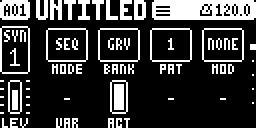
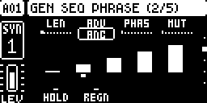
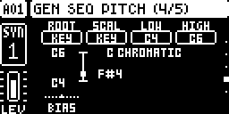
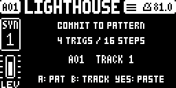
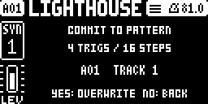
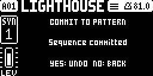

# GEN SEQ

User guide for GEN SEQ 0.4.15-dev on Digitone II OS 1.11.

This version is the beta checkpoint. Hardware confirmation is pending. Use the
[hardware checklist](genseq-beta-hardware-checklist.md) for the next instrument session.

GEN SEQ makes melodies on synth tracks. Use SEQ to keep the rhythm you programmed, FILL to add notes in its gaps, or GEN to generate the rhythm as well. Each track has its own settings for each pattern.

This guide describes the **-persist** build, which saves settings in the project. GEN SEQ supports synth tracks. MIDI-track generation is unavailable in this version. COMMIT TO PATTERN converts one captured track cycle to ordinary stock trigs.

## Open GEN SEQ

1. Select a synth track.
2. Press **[FUNC] + [SEQ]** to open Euclidean.
3. Press **[FUNC] + [SEQ]** again to open GEN SEQ.
4. Press **[UP]** or **[DOWN]** to change pages. Turn **DATA ENTRY A–H** to edit the matching control. Boxed controls keep their name visible during edits. Gauge labels briefly show the value during edits. The right-hand dots mark the selected page. Each page shows status between the two rows of controls.
5. Press **[NO]** or **[FUNC] + [SEQ]** to return to Euclidean.

Turn **LEVEL/DATA** to change track level. Hold **[FUNC]** while turning it to open LOAD PRESET. Press **[YES]** to open the actions menu.

The four upper controls use encoders A–D. The four lower controls use E–H. An empty cell has no action. A brief drawer shows the page title on entry and page changes, then the normal pattern header returns. During an edit, the drawer shows the full parameter name and value. Inactive controls show a dash and retain their settings.

Select an action with **[UP]** or **[DOWN]**. Press **[YES]** to run it. **NEW RHYTHM** picks a new seed for RANDOM rhythms in FILL or GEN. **NEW PHRASE** chooses another melody seed and rebuilds the phrase for the selected track. **COMMIT TO PATTERN** captures the selected track for use without GEN SEQ. Press **[NO]** to close the actions menu.

The sequencer makes four decisions for each note. **TRIG** decides which steps play. **PHRASE** selects a value from its loop or current anchor region. **GEN** supplies the values that fill that loop. **PITCH** and **MELODY** turn each value into a note, using the range, scale, and preferences you set. The stock track clock sets the timing.

The phrase stores values rather than fixed notes. The bar heights show these values. Changing the pitch range or melody preferences can change the heard melody while the phrase bars stay the same.

## 1. TRIG

| Encoder | Control | Function | Default |
|---|---|---|---|
| A | MODE | **OFF** plays the stock sequence. **SEQ** changes eligible pitches on existing trigs. **FILL** adds hits in gaps and generates pitches for eligible hits. **GEN** supplies the track’s sequenced hits. Live playing stays available. | OFF |
| B | BANK | **GROOVE** contains curated rhythms, **MATH** contains regular and interleaved patterns, and **RANDOM** uses repeatable seeded patterns. | GROOVE |
| C | PAT | Select pattern 1–32 from the bank. Turn faster to move through several patterns at a time. The mask repeats every 16 steps and restarts at the stock track reset. | 1 |
| D | MOD | **NONE** uses PAT as shown. **SHIFT** rotates hits. **FACTOR** redistributes hits within the cell. **NEIGHBOR** offsets the selected pattern number. | NONE |
| E | VAR | SHIFT moves −15 to +15 steps. FACTOR uses odd multipliers ×1 to ×15. NEIGHBOR offsets PAT by −15 to +15 and stops at the bank edges. Changing MOD resets VAR. | 0 or ×1 |
| F | ACT | 0% removes all generated hits. 100% enables every hit in the cell. Lower values keep a repeatable subset. | 100% |

Filled marks show programmed trigs. A center mark shows a pitch override. Hollow marks show generated hits. The underline follows the stock playhead.

BANK through ACT affect FILL and GEN. VAR shows a dash with MOD set to NONE. In FILL, a programmed note or lock trig reserves its step even when a condition prevents it from firing. SEQ works with stock Euclidean timing. Eligible single-note trigs receive generated pitches. Programmed chords and unsupported note forms keep their stock pitches.

The stock track LENGTH, SPEED, swing and reset settings control the rhythm. For example, changing track SPEED changes the timing of generated hits too. A 16-step bank cell repeats on a longer track and truncates on a shorter track. FACTOR preserves the number of hits before ACT removes any. Increasing ACT reveals a repeatable subset of the same transformed cell.

Generated source notes feed stock transpose, arpeggiation and outgoing layers. Live notes and incoming layers keep their stock behavior. GEN replaces the track's own sequenced notes and lock trigs. FILL reserves host notes and locks before conditions, and host events win timing collisions.

Changing MODE restarts the current phrase at PHASE in EVT and clears the previous-note context. In ANC, the track clock selects the current region. Mode changes retain the phrase values and seeds. MUT and REGEN can change the phrase during subsequent playback.

## 2. PHRASE

| Encoder | Control | Function | Default |
|---|---|---|---|
| A | LEN | 1–64 phrase slots. EVT advances on eligible notes. ANC spreads the slots across one track cycle. **INF** generates a continuous stream in EVT with RANDOM or WALK. Hold **[FUNC]** to step through useful lengths: INF, 1, 2, 3, 4, 6, 8, 12, 16, 24, 32, 48, and 64. | 8 |
| B | ADV | EVT counts eligible note events. ANC divides the track cycle into LEN regions. | EVT |
| C | PHASE | Starting slot, from 0 to LEN minus 1. PHASE 2 starts at the third slot. | 0 |
| D | MUT | 0–100% chance to replace a value when its slot is revisited. | 0% |
| E | HOLD | 0–100% chance in EVT to reuse the previous melodic value and pause the loop cursor for that event. | 0% |
| F | REGEN | 0–100% chance to replace the whole phrase after a loop. | 0% |

The bars show the stored phrase. The underline shows the latest slot. At
LEN INF, the bars show recent values. A changed slot briefly flashes when it
mutates.

In EVT, LEN counts notes that reach the melody generator. With four eligible notes per bar and HOLD at zero, LEN 8 plays over two bars. Rests and skipped trigs leave the cursor in place. HOLD repeats the value. MELODY can still choose a different note from that value as the previous note changes.

PHASE, MUT, HOLD and REGEN are inactive at LEN INF. FUNC snaps percentage controls to their minimum, midpoint and maximum. At HOLD 100%, the first event establishes a value and subsequent events reuse it without advancing the phrase.

ANC advances through rests. Every note in an anchor region uses that region's
latent value. PHASE rotates the regions. MUT rolls once when the clock
revisits a region. ANC disables HOLD and REGEN. Selecting ANC at LEN INF
sets LEN to 8.

ANC uses the source track's effective length and SPEED before arpeggiation and layering. LEN can exceed the number of track steps. Pause freezes the clock. A track reset returns to its PHASE-adjusted first region. Returning to EVT keeps the finite LEN. Changing ADV resets the read position to the selected mode's clock and retains the finite phrase values.

Turning MUT back to zero keeps the values already in the loop. To restore a SHAPE ramp, select **[YES] → NEW PHRASE**. STOP and PLAY return the cursor to PHASE and retain the current values.

LEN INF starts its stream again from the current seed on a fresh PLAY. Finite phrases retain their evolved values and chance state. The graphs retain recent history while stopped and clear it on a fresh start or pattern replacement.

## 3. GEN

| Encoder | Control | Function | Default |
|---|---|---|---|
| A | MODE | **RANDOM** draws independent values. **WALK** moves from the previous value. **SHAPE** samples a contour over a finite phrase. | WALK |
| B | BIAS | −100% to +100%. Favor lower or higher values in RANDOM or move the center of WALK. | 0% |
| C | STEP | 0–100%. Set how far WALK typically moves. Zero holds the current value. | 18% |
| D | DIR | −100% to +100%. Favor downward or upward motion in WALK. | 0% |
| E | GRAV | 0–100%. Pull WALK toward its center. BIAS sets where that center lies. | 25% |
| F | MOMENT | 0–100%. Set the chance that WALK keeps moving in the same direction. | 35% |
| G | SHAPE | Choose UP, DOWN, TRIANGLE, SINE, or ALTERNATE. A length of 1 uses the midpoint. | UP |

The graph shows recent values for RANDOM and WALK and the configured contour for SHAPE. STEP through MOMENT apply to WALK. SHAPE requires SHAPE mode. Selecting SHAPE from LEN INF sets LEN to 8. Hold **[FUNC]** while turning a percentage control to snap to its minimum, center, or maximum.

Editing LEN or a GEN control rebuilds the finite phrase and returns its cursor to PHASE. Changing GEN MODE uses the same melody seed, so returning from RANDOM to WALK recreates that seed's WALK phrase. NEW PHRASE chooses another seed. With SHAPE, the configured contour determines the rebuilt values.

## 4. PITCH

| Encoder | Control | Function | Default |
|---|---|---|---|
| A | ROOT | Choose C–B or inherit the root from KEYBOARD SETUP (**KEY**). | KEY |
| B | SCALE | Choose a stock named scale, CHROMATIC, or inherit the scale from KEYBOARD SETUP (**KEY**). | KEY |
| C | LOW | Set the lowest note, up to HIGH. | C4 (MIDI 48) |
| D | HIGH | Set the highest note, down to LOW. | C6 (MIDI 72) |
| E | BIAS | −100% to +100%. Give lower or higher notes more weight within the selected range. | 0% |

The center shows the legal pitch range and the latest generated note. Hold **[FUNC]** and turn LOW or HIGH to move by octaves. The bounds apply before stock transpose. If the range has no note in the selected scale, a programmed trig keeps its pitch and a generated hit stays silent.

## 5. MELODY

| Encoder | Control | Function | Default |
|---|---|---|---|
| A | MOVE | −100% to +100%. Prefer smaller or larger intervals from the previous generated note. | 0% |
| B | REPEAT | 0–100%. Set the weight for repeating the same pitch. 25% is neutral. | 25% |
| C | TONIC | 0–100%. Favor stable degrees in a named scale, with the strongest weight on its root. | 0% |
| D | RESOLVE | 0–100%. Favor a nearby stable degree after a less stable degree. | 0% |

The graph connects the last 16 generated notes. The previous generated note sets the context for MOVE and REPEAT.
TONIC and RESOLVE apply to named scales. The first generated note has no previous-note context.

With a finite EVT phrase and MUT, HOLD and REGEN at zero, MELODY context restarts at each phrase boundary. The first loop and later loops play the same melody. Infinite phrases and phrases with mutation, hold or regeneration keep their context across phrase boundaries. ANC follows the stock track clock and uses the previous realized note for each onset.

## Projects and the clipboard

GEN SEQ stores controls and rhythm and melody seeds for every synth track in all 128 patterns. Explicit project saves and the stock working-state save include them. Reopening a project or booting the instrument rebuilds each phrase from its saved controls and seeds. The saved data does not contain evolved phrase values, recent-note history or a playback cursor.

### TEMP SAVE and reload during performance

1. Set the track's GEN SEQ controls.
2. Press **[FUNC] + [YES]** to save the temporary pattern.
3. Play and change the controls, for example MUT or the pitch range.
4. Press **[FUNC] + [NO]** to restore the temporary pattern.

Reload restores the saved controls and rebuilds finite phrase values. During playback it keeps the running clock and previous-note context. You can restore MUT or pitch settings between notes without moving the start of the phrase to that beat. HOLD's chance clock also continues. Reload takes effect when the stock restore completes, without waiting for a bar boundary.

| State being restored | Playback behavior |
|---|---|
| Finite EVT to finite EVT, same LEN | Keep the advances within the current phrase loop. Apply the saved PHASE. With unchanged PHASE, the next slot stays the same. |
| Finite EVT to finite EVT, different LEN | Reduce the advances within the current loop modulo the restored LEN, then apply the saved PHASE. For example, five advances with restored LEN 4 and PHASE 0 select slot 2 next. |
| ANC to ANC | Resolve the current region from the stock track position, restored LEN and PHASE. |
| INF EVT to INF EVT | Continue the current generator stream. Restored controls affect subsequent values. The restored seed takes effect when the stream is restarted. |
| EVT to ANC | Use the current stock track position. |
| ANC to EVT, or finite to INF or back | Start the destination phrase at its saved PHASE, or start INF from the saved seed. |
| Previously OFF track restored to an active mode | Initialize its phrase. EVT starts at PHASE and ANC uses stock track time. |
| Restore while stopped | Prepare the saved phrase for its normal fresh start. |

Reload restores musical values at the position currently running, so pitches can change immediately. A prior LEN or GEN edit may already have restarted the cursor. Reload keeps that new position.

MUT and REGEN continue using their running chance streams. Compatible prepared REGEN values remain available. Changing LEN or generator settings requires a new replacement bank, which can defer the first REGEN swap to a later wrap. To restart deliberately, use STOP and PLAY or NEW PHRASE.

### Track and pattern clipboard

Hold **[TRACK]** and press **[COPY]** to copy the track preset and its GEN SEQ controls and seeds. Select the destination track. Hold **[TRACK]** and press **[PASTE]**. This also works between patterns. The destination keeps its programmed trigs.

Press **[TRACK] + [PASTE]** again to undo the paste. **[TRACK] + [CLEAR]** resets the preset and GEN SEQ settings. Repeat it to undo. Copying a track with no GEN SEQ settings switches the destination's GEN SEQ mode to OFF.

Normal Grid Recording sequence copy, paste, clear and undo include GEN SEQ settings. Sequence paste copies the sequence and its stock track length while retaining the destination sound. Full-pattern copy and paste include all tracks' settings. Loading a sound preset through LOAD PRESET keeps the track's GEN SEQ settings.

Clipboard paste, clear and undo retain their normal phrase initialization behavior. The live clock-preserving behavior above applies to pattern reload. Builds without **-persist** retain settings only for the current session.

## Commit to a pattern

COMMIT TO PATTERN records the pitches heard during one complete stock track cycle. It writes normal trigs and switches GEN SEQ OFF at the destination. The result can play without the mod.

1. Select the source synth track. Open GEN SEQ.
2. Press **[YES]**. Select **COMMIT TO PATTERN** with **[UP]** or **[DOWN]**. Press **[YES]**.
3. Press **[PLAY]** if stopped. If playback is already running, leave it running. Capture waits for the next complete track cycle. It finishes at the following cycle boundary. Keep playing while it captures.
4. Review the trig count and track length. You can press **[STOP]** after capture finishes.
5. Turn **A** to select a destination pattern. Turn **B** to select a synth track. The source pattern and track are selected first. You can overwrite them, or any occupied destination.
6. Press **[YES]** to review the destination and length. Press **[YES]** again to overwrite its sequence. Press **[NO]** at confirmation to return to destination selection.
7. At **Sequence committed**, press **[YES]** to undo the commit. Undo restores the sequence, track length and GEN SEQ settings together. Press **[NO]** to leave this screen. Your normal clipboard stays available.

The capture length comes from stock track LENGTH, not PHRASE LEN. For example, a track cycle with five onsets captures five realized pitches even when PHRASE LEN is six. The committed track repeats those five onsets. Increase stock track LENGTH before capture if you want a longer result. Trailing rests count toward the captured track length.

SEQ retains programmed rhythm, timing, conditions, locks and retrigs. It replaces pitches that GEN SEQ resolved during capture. An untouched or silent conditional trig keeps its original pitch. FILL keeps the host sequence and adds the captured generated hits. It flattens stock Euclidean and source-step mappings onto the normal grid. GEN writes only the captured generated hits and turns off Euclidean processing.

Pitches are captured before stock transpose, arpeggiation and trigger layering. Live keyboard notes and incoming layers are not recorded. The destination keeps its own sound, transpose, arp and layer settings. These settings can change how the committed sequence sounds. GEN SEQ settings remain at the destination with MODE set to OFF. Turning it back on processes the committed sequence again.

If resizing would change a shared PER PATTERN length, **USE PER TRACK** appears. The capture remains available. Choose another destination, or set its stock length mode to PER TRACK and retry. **[NO]** clears this message and returns to destination selection. **[NO]** from destination selection discards the capture.

STOP before capture finishes cancels the capture. Changing the source track, pattern, GEN SEQ parameters or programmed sequence during capture also cancels it. The destination stays unchanged. If several different pitches map to one stored source step, the editor shows that step and refuses the write. A full pattern lock or note pool also prevents the write. A stock reset that interrupts the selected track cycle requires another capture with a complete cycle available.

Save the project normally to keep the committed sequence. The capture itself is temporary and is not saved. The immediate Undo prompt is available before you leave the result screen. Later clipboard and recording operations follow stock undo rules.

## Try three sequences

### SEQ ramp

1. Program single-note trigs on steps 1, 5, 9, and 13.
2. Set TRIG MODE to SEQ.
3. Set PHRASE LEN to 4.
4. Choose SHAPE UP on GEN.
5. Set PITCH LOW and HIGH one octave apart.
6. Press **[PLAY]**.

Raise MUT to vary the ramp after the first loop. Set MUT to zero. Select NEW PHRASE to restore the ramp.

### FILL on a bass track

1. Program notes on steps 5 and 13.
2. On TRIG, set MODE to FILL, BANK to GROOVE, PAT to 3, and ACT to 100%.
3. Press **[PLAY]**.
4. Select SHIFT for MOD.
5. Turn VAR to move the added hits.
6. Reduce ACT to hear fewer added hits.

### GEN on an empty track

1. On TRIG, set MODE to GEN, BANK to RANDOM, and PAT to 1.
2. Set PHRASE LEN to 8.
3. Choose WALK on GEN.
4. Set a named scale and a one-octave range on PITCH.
5. Press **[PLAY]**.

Turn ACT down to thin the rhythm. Use NEW RHYTHM to pick another cell.

### Return from a live mutation

1. On TRIG, set MODE to GEN, BANK to GROOVE, PAT to 22, and ACT to 100%.
2. Set PHRASE to LEN 6, ADV EVT, PHASE 0, MUT 0%, HOLD 0%, and REGEN 0%.
3. Select WALK.
4. Set a pitch range you can recognize.
5. Press **[FUNC] + [YES]**, then **[PLAY]**.
6. Raise MUT and let the melody evolve.
7. Press **[FUNC] + [NO]** between phrase boundaries.

The saved WALK values return at the current phrase position. Notes retain the stock rhythm. Use ANC instead if you want phrase position to follow the track cycle through rests and rhythm changes.
